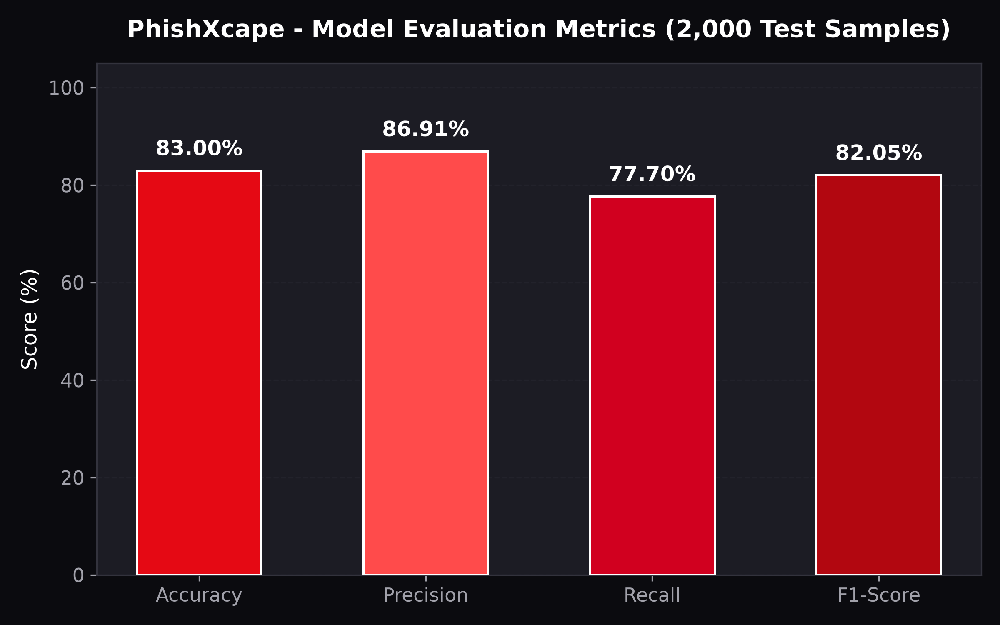
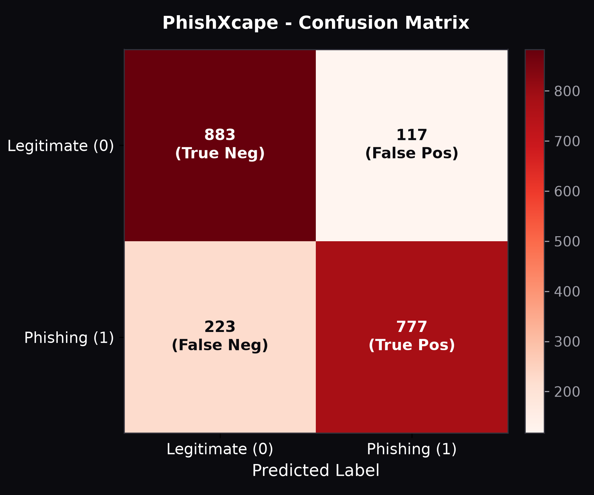
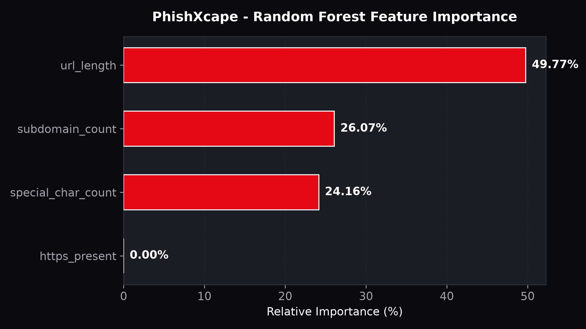

# PhishXcape – Real-Time Phishing Detection Browser Extension

[](https://developer.chrome.com/docs/extensions/mv3/)
[](https://scikit-learn.org/)
[](https://github.com/)
[](LICENSE)

**PhishXcape** is a high-performance, privacy-first cybersecurity browser extension that detects phishing and deceptive websites in real-time. It combines an **offline 100-tree Random Forest machine learning model** (running directly inside browser memory with zero network delay) with **Google Safe Browsing** and **VirusTotal** threat intelligence feeds.

---

## Architecture Overview

PhishXcape employs a multi-layer hybrid defense architecture that decouples instantaneous local heuristic scanning from asynchronous cloud threat verification:


### Multi-Layer Security Pipeline:
1. **Navigation Event**: The user navigates to a URL. The Manifest V3 background service worker intercepts the active tab's address.
2. **Feature Extraction**: 4 deterministic URL security features are extracted locally in under $0.05\text{ ms}$.
3. **Offline ML Inference**: An in-memory JavaScript Random Forest classifier evaluates the feature vector across 100 decision trees (average inference latency: $0.008\text{ ms}$).
4. **Cloud Threat Intelligence**: If internet access and user-configured API keys are available, Google Safe Browsing and VirusTotal are queried asynchronously in parallel.
5. **Multi-Layer Decision Policy**: The verdicts are evaluated hierarchically:
   - **Confirmed API Hit** $\rightarrow$ Immediate Critical `PHISHING` Alert.
   - **High-Confidence ML ($Score \ge 80\%$)** $\rightarrow$ High-Risk `PHISHING` Alert.
   - **Moderate ML / Isolated Vendor Flag** $\rightarrow$ `SUSPICIOUS` Warning.
   - **Clean ML & Clean APIs** $\rightarrow$ `SAFE` Verification.
   - **Internal Browser Pages (`chrome://`)** $\rightarrow$ Exempt `UNKNOWN / BROWSER`.
6. **User Warning & In-Page Banner**: If high risk is detected, a prominent warning is displayed in both the extension popup and an in-page floating banner.

---

## Technological Stack

- **Frontend**: HTML5, CSS3, JavaScript (ES6+), Chrome Manifest V3
- **Color Palette**: Red (`#E50914`, `#B20710`), Black (`#0B0B0F`, `#15151B`), White (`#FFFFFF`, `#F2F2F2`)
- **Machine Learning**: Python 3.13, Scikit-learn, Pandas, NumPy, Matplotlib, Joblib
- **Inference Runtime**: Standalone JavaScript tree evaluator (zero external npm dependencies in extension bundle)
- **Threat Intelligence**: Google Safe Browsing Lookup API (v4), VirusTotal REST API (v3)

---

## Dataset Verification & Preparation

The project was trained using the verified dataset `urlset.csv`:

| Metric | Raw Parsed Value | Cleaning & Sampling Protocol |
| :--- | :--- | :--- |
| **Total Rows** | 96,011 | Loaded via Latin-1 encoding |
| **Clean Parsed Rows** | 96,005 | Malformed rows audited and skipped |
| **Malformed Records** | 98 rows | Unescaped newlines / column count deviations |
| **Missing Labels** | 92 records | Dropped during validation |
| **Duplicate Domains** | 2 records | Deduplicated |
| **Class Distribution** | 48,009 Legit / 47,902 Phish | 50.05% Legit / 49.95% Phish |
| **Balanced Sample** | **10,000 URLs** | **5,000 Legitimate (0) & 5,000 Phishing (1)** |
| **Reproducibility** | `random_state=42` | Shuffled and saved to `model/phishing_urls.csv` |

### Handling of Scheme-Less URLs in the Dataset:
In `urlset.csv`, URLs are stored primarily in raw hostname/path format (e.g., `dniash.solidwebhost.com/...`). In adherence to cybersecurity standards:
- PhishXcape **never invents missing HTTPS schemes**.
- Scheme-less URLs receive a score of `0` (unverified scheme).
- When operating in the Chrome browser extension, live tabs provide the fully qualified URL (e.g. `https://domain.com`), where HTTPS receives `1`.

---

## The 4 URL Security Features

Feature extraction is implemented identically in Python (`model/feature_extraction.py`) and JavaScript (`extension/utils/feature_extraction.js`):

```
       1. HTTPS Presence     --> Explicit 'https://' prefix check (1 = HTTPS, 0 = Non-HTTPS/None)
       2. URL Length         --> String character length len(url)
       3. Subdomain Count    --> Public suffix-aware domain parsing (e.g. .co.uk, .com.au)
       4. Special Chars      --> Occurrences of: [-._~:/?#[]@!$&'()*+,;%=\^|{} `"\\<>]
```

---

## Model Training & Performance Results

Trained on 8,000 samples and evaluated against 2,000 held-out test samples (stratified 80:20 split, `random_state=42`):

```
+-------------------------------------------------------------------+
|                     PHISHXCAPE MODEL METRICS                      |
+-------------------+-----------------------------------------------+
| Metric            | Evaluation Score (2,000 Test Samples)         |
+-------------------+-----------------------------------------------+
| Accuracy          | 83.00%                                        |
| Precision         | 86.91%                                        |
| Recall            | 77.70%                                        |
| F1-Score          | 82.05%                                        |
+-------------------+-----------------------------------------------+
```

### Confusion Matrix Breakdown:
- **True Negatives (Legitimate classified as Legitimate)**: 883
- **False Positives (Legitimate misclassified as Phishing)**: 117
- **False Negatives (Phishing misclassified as Legitimate)**: 223
- **True Positives (Phishing correctly blocked)**: 777

### Feature Importances:
1. **URL Length**: $49.77\%$ (Primary differentiator for obfuscated payload URLs)
2. **Subdomain Count**: $26.07\%$ (Deceptive multi-level branding indicators)
3. **Special Character Count**: $24.16\%$ (Dense encoding and query parameters)
4. **HTTPS Presence**: $0.00\%$ in raw scheme-less dataset, active during real-time extension execution.

### Performance Visualizations:
| Evaluation Metrics | Confusion Matrix | Feature Importance |
| :---: | :---: | :---: |
|  |  |  |

---

## Project Structure

```
PhishXcape/
├── data/
│   └── urlset.csv                       # Primary dataset (96,005 raw rows)
├── model/
│   ├── inspect_dataset.py               # Encoding and malformed row auditor
│   ├── select_samples.py                # Balanced 10,000 URL extractor
│   ├── feature_extraction.py            # Python 4-feature extraction logic
│   ├── train_model.py                   # Random Forest trainer & evaluator
│   ├── export_model.py                  # Scikit-learn to JSON tree exporter
│   ├── generate_architecture_diagram.py # Matplotlib architecture diagram generator
│   ├── phishing_urls.csv                # Balanced dataset (5,000 legit, 5,000 phish)
│   ├── random_forest.pkl                # Serialized Python model
│   └── random_forest_model.json         # Exported 100-tree model JSON
├── extension/
│   ├── manifest.json                    # Chrome Manifest V3 configuration
│   ├── popup.html                       # Red/Black/White UI popup interface
│   ├── popup.css                        # Modern dark cybersecurity styling
│   ├── popup.js                         # Dynamic UI event handling
│   ├── background.js                    # Core background controller module
│   ├── service_worker.js                # Authoritative MV3 background worker
│   ├── contentScript.js                 # In-page security alert banner
│   ├── utils/
│   │   ├── feature_extraction.js        # JavaScript feature extraction
│   │   ├── random_forest_predict.js     # Standalone offline RF inference
│   │   ├── threat_intel.js              # Google Safe Browsing & VirusTotal
│   │   └── decision_engine.js           # Multi-layer decision policy
│   ├── model/
│   │   └── random_forest_model.json     # Bundled model for offline inference
│   └── icons/
│       ├── icon16.png
│       ├── icon48.png
│       └── icon128.png
├── Output/
│   ├── accuracy_chart.png               # Metric comparison chart
│   ├── confusion_matrix.png             # Confusion matrix heatmap
│   ├── feature_importance.png           # Feature weighting chart
│   └── Architecture diagram.png         # High-resolution system architecture
├── tests/
│   ├── test_features.py                 # Feature extraction test suite
│   ├── test_model.py                    # Python model validation test suite
│   ├── test_inference.js                # JS inference & parity test suite
│   └── test_detection.js                # Multi-layer decision & edge case tests
├── requirements.txt                     # Python dependencies
├── .gitignore                           # Git ignore rules
└── README.md                            # Complete documentation
```

---

## Installation & Setup Instructions

### 1. Python Environment Setup
Ensure Python 3.10+ is installed. Clone the repository and install requirements:

```bash
git clone https://github.com/your-username/PhishXcape.git
cd PhishXcape

# Create and activate virtual environment
python -m venv venv
# Windows:
venv\Scripts\activate
# Linux/macOS:
# source venv/bin/activate

# Install dependencies
pip install -r requirements.txt
```

### 2. Dataset Preparation & Model Retraining
Run the automated pipeline to inspect data, sample balanced records, train the Random Forest, and export the JavaScript bundle:

```bash
# 1. Audit dataset encoding and malformed records
python model/inspect_dataset.py

# 2. Select 10,000 balanced records (5,000 legit, 5,000 phish)
python model/select_samples.py

# 3. Train model, evaluate metrics, and save visualizations
python model/train_model.py

# 4. Generate high-resolution architecture diagram
python model/generate_architecture_diagram.py

# 5. Export Random Forest model to extension bundle
python model/export_model.py
```

### 3. Run Automated Verification Tests
Run the Python and JavaScript unit test suites:

```bash
# Test Python feature extraction & URL edge cases
python -m unittest tests/test_features.py

# Test Python model deserialization & latency
python -m unittest tests/test_model.py

# Test JavaScript feature extraction parity & 0.008ms inference
node tests/test_inference.js

# Test Multi-Layer Decision Engine & threat scenarios
node tests/test_detection.js
```

---

## Loading Extension into Google Chrome

1. Open **Google Chrome**.
2. Navigate to `chrome://extensions/` in the address bar.
3. Enable **Developer mode** using the toggle switch in the top-right corner.
4. Click the **Load unpacked** button.
5. In the file picker, select the `extension` folder inside this repository:
   ```
   C:\Phishing detection proj\extension
   ```
6. The **PhishXcape** extension will appear in your extensions list and pin to your toolbar.
7. Click the shield icon on any tab to view the live scan, test custom URLs, or configure threat intelligence API keys.

---

## Threat Intelligence API Configuration

PhishXcape functions **100% offline out-of-the-box** using its bundled Random Forest model.

To enable live Google Safe Browsing and VirusTotal cloud checks:
1. Open the PhishXcape popup in Chrome.
2. Click the **Settings** gear icon in the top header.
3. Enter your personal API keys:
   - **Google Safe Browsing API Key**: Available from Google Cloud Console.
   - **VirusTotal API Key**: Available from VirusTotal Community/Enterprise account.
4. Click **Save Keys**.
5. Keys are stored strictly in your browser's private local storage (`chrome.storage.local`) and are **never transmitted to third-party tracking servers**.

---

## Privacy & Security Principles

- **Zero Browsing History Harvesting**: PhishXcape never records or logs your navigation history.
- **Zero Hardcoded Secrets**: No sensitive API keys or credentials are baked into public source files.
- **Fail-Safe Offline Mode**: If your computer is disconnected from the internet or APIs fail, the extension automatically relies on its embedded Random Forest model without blocking your workflow.
- **Transparent Model Scoring**: Confidence scores are explicitly labeled as model ensemble voting consensus, not synthetic real-world Bayesian probabilities.

---

## Original Future Roadmap

- [ ] **Deep Learning Engine**: Implement a client-side character-level LSTM neural network using TensorFlow.js.
- [ ] **Multi-Browser Expansion**: Package extensions for Mozilla Firefox (Manifest V2/V3), Microsoft Edge, and Apple Safari.
- [ ] **Heuristic Analytics Dashboard**: An opt-in visual dashboard for security researchers to analyze anomalous token frequencies.
- [ ] **Automated Threat Rule Sync**: Background incremental sync for newly discovered phishing patterns via WebAssembly.
- [ ] **Multilingual Phishing Detection**: Targeted heuristic analysis for internationalized domain names (IDN homograph attacks) and Cyrillic/Greek script impersonation.

---

## License

This project is licensed under the MIT License. See `LICENSE` for details.
